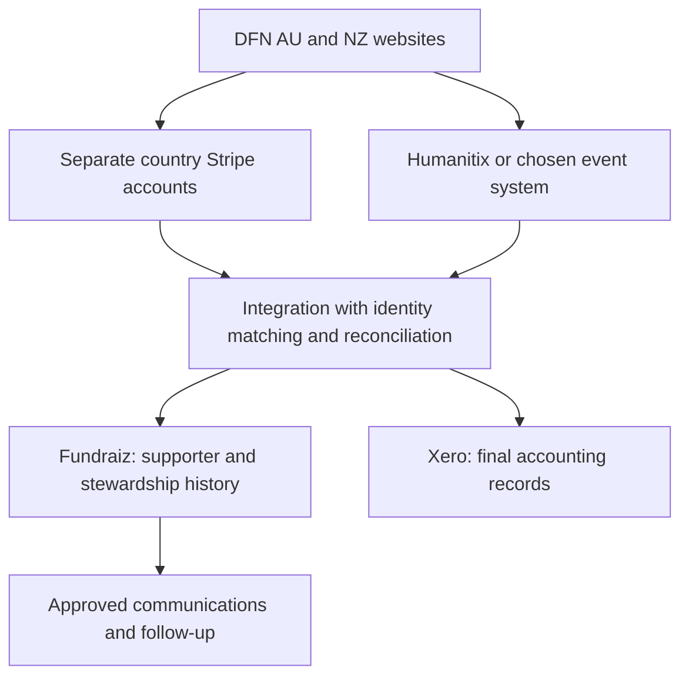

# Fundraiz fit for DFN: CRM, Stripe and event platforms

Research date: 27 September 2026. Decision support, not an approved vendor or architecture decision.

Call follow-up, reviewed 15 October 2026: see the [timestamped meeting responses](fundraiz-meeting-questions.md). Carlos described Enterprise parent/child entities for AU/NZ, vendor-managed sponsorship customisation and embedded widgets as the current website approach. He ruled out BYO Stripe checkout within Fundraiz, but did not clearly answer the separate external-Stripe-to-CRM API proposal. Humanitix API integration was discussed without establishing its implementation. Treat the compatibility options below as pre-call hypotheses, not confirmed supported configurations. The call also raised questions about automatic merging, staff control of fields, AI learning and commercial terms.

## Recommendation

**Fundraiz merits a requirements-led demonstration, but the evidence does not yet justify replacing Infoodle.** Its apparent advantage is integrated fundraising communications and automation. DFN's selection hinges on sponsorship, AU/NZ separation, financial attribution, consent and migration—areas where broad feature claims are insufficient.

Keep Infoodle as the baseline to beat. Test Fundraiz with representative, synthetic DFN cases before committing to migration. Do not make the website rebuild depend on this decision: the accepted architecture already separates public content from operational systems.

| Question | Answer |
| --- | --- |
| Useful as our CRM? | Potentially, subject to proving the hard requirements below. It is a credible candidate to investigate, not yet a demonstrated replacement. |
| Compared with Infoodle? | Fundraiz presents a more integrated fundraising/communications proposition. Infoodle has substantially stronger evidence for DFN's actual relationship, sponsorship and finance workflows, plus lower migration disruption. |
| Can we retain Stripe? | Yes as a proposed architecture, and Fundraiz explicitly advertises Stripe integration. Whether it supports DFN-owned checkout and existing subscriptions with the required fidelity still needs demonstration. |
| Can we retain Humanitix? | Yes as the event system. Humanitix provides outbound data paths, but a complete Humanitix → Fundraiz event-history integration is not established by the public material. |
| Other event systems? | Fundraiz lists Eventbrite; TryBooking and Ticket Tailor expose integration mechanisms. Each still needs a suitable receiving model in Fundraiz. |

Integration evidence: [Fundraiz integrations](https://www.fundraiz.ai/integrations), [Humanitix API](https://help.humanitix.com/en/articles/8888275-public-api-documentation), [TryBooking API](https://learn.trybooking.com/en/articles/41733-trybooking-api), [Ticket Tailor webhooks](https://help.tickettailor.com/en/articles/5149215-how-can-i-create-a-webhook).

## What DFN actually needs

Read before assessing the vendors:

- [CRM/DMS/EMS requirements](../prds/specs/007-crm-dms-ems.md), including hard selection criteria and unresolved ownership decisions.
- [Giving](../prds/specs/003-giving.md), [sponsorship](../prds/specs/004-sponsorship.md), [events](../prds/specs/005-events.md) and [engagement](../prds/specs/006-engagement.md).
- [Country Site vocabulary](../../CONTEXT.md), [accepted website architecture](../adr/001-website-technical-architecture.md) and [content/operational ownership](../adr/003-authored-content-and-operational-state-ownership.md).
- [Earlier CRM comparison](../prds/crm-selection-report.md), [Infoodle documentation research](infoodle-documentation-context.md) and [13 September Infoodle inspection](infoodle-current-state-2026-09-13.md).

### Scope correction after checking the originating chat

The initial research used the saved reports produced by [Find Infoodle CRM access options](codex://threads/01a09882-259c-7953-98cb-815f2516b5dc), but did not read that chat directly. Follow-up verification found its later discussion flagged stale PRD wording. The underlying GitHub decisions were checked directly and take precedence:

- **One shared AU/NZ CRM/DMS/EMS setup is already agreed.** Evaluate entity scoping, independent exports and future separation within that shared setup; do not reopen separate launch instances as the default choice. [Recorded decision and remaining work](https://github.com/dfn-au/dfn-web/issues/23#issuecomment-4796591518)
- **Public website child sponsorship is deferred.** It was removed from the current website and is unlikely to return. Existing external sponsorship obligations and records are not thereby ended. Sponsorship tests below concern CRM stewardship and migration, not a requirement to build public profiles or sponsorship checkout for launch. [Scope update](https://github.com/dfn-au/dfn-web/issues/10)

The chat's other proposed requirements updates were awaiting user confirmation; they are not treated here as accepted decisions merely because an assistant proposed them.

These establish the following evaluation priorities:

1. **Entity separation:** AU and NZ activity, payment accounts, gifts, subscriptions, receipts, senders, access and exports must retain their context. Multiple currencies or teams alone do not establish this.
2. **Stewardship data:** individuals, households, relationships, acquisition source, notes, giving history and reviewable duplicate handling.
3. **Finance:** gifts with campaign and designation lines, mixed tax treatment where needed, offline gifts and reliable Xero reconciliation. A direct Xero connector is desirable; reliable export is acceptable.
4. **Sponsorship:** sponsor–programme/child relationships, status, payment cadence, recipient matching and update/send history. This is a hard requirement, not an optional fundraising feature.
5. **Recurring payments:** a failure must result in visible staff follow-up with clear ownership and completion, not merely a provider notification.
6. **Communications:** explicit preferences, consent provenance, suppression and separate vetted status for prayer updates.
7. **Events:** purchaser and attendee history, attendance and payment status. The CRM need not operate ticket sales.
8. **Migration and operation:** complete exports, sensitive-data access controls, maintainability and total cost.

AI scoring, social scheduling, advanced dashboards and peer-to-peer tooling are secondary to these requirements. Several promoted capabilities extend beyond website launch scope.

### What the existing Infoodle investigation changes

The September inspection found approximately 8,957 visible non-archived records and 70,929 transactions. These are view counts, not audited unique-donor totals. It also found household/receipt conventions, separate student records linked to sponsors, update-email history and saved missing-payment reports. Replacing this entails relationship and history migration, not simply uploading an email list.

Two qualifications matter: the observed Xero connection was **disconnected**, and receipt history/templates were present in Infoodle. Therefore neither current automated Xero sync nor “all receipts come from Xero” should be assumed. The NZ/GDG handoff remains unresolved. Current practices inform discovery; they do not mandate reproducing old fields or manual processes. [Existing inspection](infoodle-current-state-2026-09-13.md)

## Evidence and comparison

“Advertised” means the vendor says it provides a capability. “Documented” means a more specific public workflow/API is described. Neither means an authenticated DFN test passed. “Not established” means this research could not verify it, not that the feature necessarily does not exist.

| DFN dimension | Fundraiz evidence and unresolved fit | Infoodle comparison | Decision implication |
| --- | --- | --- | --- |
| Core CRM | Contacts, custom fields, segmentation and donor records are presented; API examples support basic contact writes. Household financial behaviour and complex relationships need proof. | Existing DFN records demonstrate households, relationships, notes and donor history. | Test joint receipts and shared emails, not just individual contacts. |
| AU/NZ | Enterprise advertises multiple organisations. Separate legal/entity accounting, preferences, payment connections and clean exports remain unproven. | DFN currently shares a site with several country markers; enforcement remains unverified. One Xero organisation per site is documented. | Prove the agreed shared setup can enforce entity scoping and support a future split. Neither candidate receives an automatic pass. |
| Xero/finance | Xero is listed as an integration. Object mappings, direction, split allocations, fee reconciliation and correction handling were not established. | Detailed contact/account-code/transaction integration documentation exists. Actual DFN connection needs resolving. | Infoodle has stronger workflow evidence; require a reconciled Fundraiz example. |
| Receipts | Receipt automation is documented, but DFN-specific AU/NZ, mixed-purpose and GDG handling needs proof. | Existing issued receipts and templates are observed. | Select one owner for official receipts; avoid duplicate issuance. |
| Sponsorship | A DFN-equivalent relationship and update-history workflow was not established. General custom fields do not prove it. | Separate student/sponsor records, Person Links and an actual update send were observed. Coverage and lifecycle edge cases remain open. | This is the largest replacement gate. |
| Payment failures | Public webhook events include recurring-payment failure. Assignment, close-out and externally created Stripe subscription support need proof. | Stripe failure notifications/plan history are documented; DFN saved reports identify missing payments. Reliable staff execution remains unverified. | Test failure → assigned action → recovery/closure in both products. |
| Consent/EMS | Integrated communications and automation are a prominent proposition. Per-topic/per-entity suppression, consent evidence and prayer approval need testing. | DFN groups, exclusions and email history are populated, but archived Mail Types and report-based suppression create unresolved workflow questions. | A meaningful opportunity for improvement, if migration preserves suppression and eligibility. |
| Event history | Native events and Eventbrite integration are advertised. External attendee history ingestion is not demonstrated by the published API. | Event capabilities exist; DFN observed response groups/history need a staff walkthrough. | Keep ticket operations in a specialist tool if desired; test the CRM history separately. |
| Migration/export | Generic imports and exports are promised. No verified Infoodle-specific migration was found. | Avoids replacement migration, but still needs cleanup and a website integration. | Compare the work and outcomes of improving Infoodle with switching. |
| AI and reporting | Predictive donor engagement and unified reporting are advertised. DFN-specific accuracy and net staff-time savings are untested. | Existing saved reports encode useful operations, including mixed legacy semantics. | Use a controlled pilot with staff outcomes; do not value vendor ROI claims as DFN forecasts. |

Fundraiz sources: [features](https://www.fundraiz.ai/features), [pricing](https://www.fundraiz.ai/pricing), [integrations](https://www.fundraiz.ai/integrations), [API](https://www.fundraiz.ai/api-docs). Infoodle sources: [current-state inspection](infoodle-current-state-2026-09-13.md), [Xero setup](https://help.infoodle.com/docs/how-to-connect-to-xero), [connections](https://help.infoodle.com/docs/custom-fields-connections), [recurring notifications](https://help.infoodle.com/docs/recurring-payment-notifications).

Infoodle's Xero limitation is material: a site has one organisation connection, shared across its clusters. Two legal entities needing two direct Xero connections require a deliberate design. Fundraiz's multi-organisation label must likewise be tested for real financial isolation rather than assumed to solve it. [Infoodle Xero documentation](https://help.infoodle.com/docs/how-to-connect-to-xero)

Fundraiz's religious-sector page does mention families, giving funds, consolidated statements and recurring Stripe gifts. Its education page mentions relationships between alumni, parents and donors. These improve the evidence for basic relationship/fund support, but neither demonstrates child sponsorship or mixed-tax split gifts. The religious page's IRS receipt wording is not evidence of AU/NZ receipt suitability. [Religious-sector offering](https://www.fundraiz.ai/solutions/religious), [education offering](https://www.fundraiz.ai/solutions/education)

Its feature page also advertises confidence-based, side-by-side duplicate review and history-preserving merges. That is aligned with DFN's intent; verify how this interacts with the API's email-based duplicate detection, particularly for households and guests sharing an address. [Features](https://www.fundraiz.ai/features), [API](https://www.fundraiz.ai/api-docs)

## Cost, migration and vendor assurance

### Budget for the configuration DFN needs

| Plan | Monthly price shown on homepage | Relevant dedicated pricing-page limits |
| --- | --- | --- |
| Starter | US$299 | 5,000 contacts, 3 staff, 1 organisation |
| Growth | US$599 | Unlimited contacts, 10 staff, 1 organisation; API and journeys included |
| Enterprise | Quote | Multiple organisations, unlimited users, custom integrations and SLA |

The homepage specifies USD; the terms default to AUD unless otherwise specified. Obtain a written currency/tax-specific quote. There is also inconsistent API positioning: the homepage emphasises it under Enterprise, the pricing page includes it in Growth, and API documentation supplies Starter rate limits. Do not infer contractual entitlement from these conflicting summaries. [Homepage](https://www.fundraiz.ai/), [pricing](https://www.fundraiz.ai/pricing), [terms](https://www.fundraiz.ai/terms), [API](https://www.fundraiz.ai/api-docs)

At the advertised monthly rate, Growth annualises to **US$7,188**, before usage, taxes and implementation. Obtain a quote for the agreed shared AU/NZ setup: whether Growth can meet its entity-scoping requirements or Enterprise is required remains unproven. The observed Infoodle record count exceeds Starter's limit; establish migration scope rather than discarding useful records to meet it.

Infoodle prices by active contacts, excludes archived contacts from that count, and has no per-user charge. Finance and events are optional packages. Its published API offering is available on all plans, subject to access/configuration. Compare DFN's actual invoice plus improvement costs with a Fundraiz quote including migration, entity setup, messages, transaction charges, integrations, support and maintenance. No like-for-like price advantage is established here. [Infoodle pricing](https://www.infoodle.com/pricing/), [API access](https://www.infoodle.com/integration-api/)

### Migration and exit require evidence

Fundraiz advertises CSV and several named CRM imports, but not an Infoodle-specific migration. Generic import support does not prove retention of DFN's linked records or history. [Pricing FAQ](https://www.fundraiz.ai/pricing)

Its privacy policy promises CSV/JSON exports and a 90-day post-termination retention period, followed by deletion/purge within a further 30 days. Terms say access ends on termination, with export requested from the provider. Do not assume that retention means continued self-service access. Require a sample export and written coverage of relationships, attachments, historical sends, consent and stable identifiers. [Privacy policy](https://www.fundraiz.ai/privacy), [terms](https://www.fundraiz.ai/terms)

### Assurance has a material inconsistency

**The pricing FAQ says “SOC 2 compliant”; the July 2026 Trust Centre says Type I is in progress targeting Q1 2027 and Type II is planned for Q4 2027.** Treat completed independent assurance as unverified and ask for clarification. [Pricing FAQ](https://www.fundraiz.ai/pricing), [Trust Centre](https://www.fundraiz.ai/trust-centre)

The Trust Centre publishes Sydney hosting for AU/NZ, encryption, client MFA, backups/restoration testing, exclusion of client data from AI training and human approval of AI outputs. These are vendor statements, not controls tested in this research. It lists US processing by Stripe and SendGrid/Twilio; Australian hosting does not mean all processing stays in Australia. Obtain the actual agreement, subprocessor/data-flow details, recovery commitments and relevant assurance reports. [Trust Centre](https://www.fundraiz.ai/trust-centre)

The privacy policy distinguishes child service users from minors' data uploaded by client organisations; it does not establish a blanket prohibition on student records. Nevertheless, DFN needs demonstrated restrictions on child records and exclusion of sensitive information from inappropriate enrichment, audiences and exports. [Privacy policy](https://www.fundraiz.ai/privacy)

Fundraiz's own timeline dates private beta to June 2025 and global opening to Q1 2026. This is a young product; staff fundraising experience is not the same as platform operating history. Request comparable AU/NZ customer references covering migration, sponsorship and finance, and evidence for any claimed AI uplift before assigning it financial value. [About Fundraiz](https://www.fundraiz.ai/about)

## Stripe: compatible, with two different integration choices

### Fundraiz-owned giving forms

Fundraiz explicitly lists Stripe as a payment integration. That supports investigating Fundraiz forms backed by Stripe. The integration's “Learn more” button redirected to sign-in, so public inspection did not establish account ownership, subscription portability, AU/NZ account routing or complete lifecycle behaviour. [Integration catalogue](https://www.fundraiz.ai/integrations)

This approach might reduce donation-form implementation work. It is only useful if the forms preserve DFN's country, purpose, campaign and designation attribution and the chosen donor experience. Existing sponsorship payments need their operational relationship preserved, but new public sponsorship checkout is outside the agreed website launch scope.

### DFN-owned website checkout, with Fundraiz downstream

This is a technically plausible design, not a tested connector:

1. The fixed AU/NZ website configuration selects the appropriate Country Payment Account.
2. Stripe processes the payment and owns the agreed subscription/retry behaviour.
3. An integration records the resulting gift and relevant status in the CRM.
4. Staff handle unresolved failures in the CRM; Xero remains final accounting truth.

Stripe documents subscription, payment-failure and refund notifications. Its webhook guidance also covers delivery retries, duplicates and ordering, so an integration must handle repeated and delayed messages safely. [Stripe subscription webhooks](https://docs.stripe.com/billing/subscriptions/webhooks), [webhook handling](https://docs.stripe.com/webhooks)

**The receiving API is the main unknown.** Fundraiz documents contact creation with custom fields and donation recording against an existing contact. Its donation example includes amount, currency, campaign, method and date, and states that receipt generation follows organisation settings. It also lists refund and recurring-failure webhook events. The public examples do not establish designation arrays, entity fields, external payment IDs, idempotent writes, external recurring-plan updates, or event/sponsorship/consent write APIs. Clarify its inconsistent base-path examples and plan entitlement before estimating implementation. [Fundraiz API documentation](https://www.fundraiz.ai/api-docs)

Ask Fundraiz to demonstrate both an existing Stripe subscription and one created by DFN checkout. A connector that only understands payments created through its own forms is a different capability from importing all relevant activity in a Stripe account.

Keep a stable mapping of source system, country/entity, payment account, payment/subscription ID, CRM record ID and accounting reference. Define a single ingestion route per transaction. Otherwise native sync plus a custom importer can duplicate gifts. This is a proposed DFN design requirement, not a claim about existing Fundraiz behaviour.

Stripe compatibility is not unique to Fundraiz: Infoodle explicitly supports existing Stripe accounts and adds no Infoodle transaction fee. Its documented recurring notifications require configuration and Stripe updates; retry ownership remains with Stripe. [Infoodle payment gateways](https://www.infoodle.com/integration-payments/), [recurring notifications](https://help.infoodle.com/docs/recurring-payment-notifications)

## Humanitix and other ticketing systems

**Keep Humanitix if it best meets the event requirements. CRM selection does not require replacing it.** Fundraiz's public catalogue did not list a Humanitix connector when inspected.

There are three realistic routes to investigate:

| Route | Evidence | Remaining work |
| --- | --- | --- |
| Humanitix → integration service → Fundraiz | Humanitix has a read-only API for events, orders, tickets and tags; Fundraiz documents contact writes. | Confirm where multiple event participations, attendance, cancellations and payment status can be written in Fundraiz. |
| Humanitix → Zapier → Fundraiz | Humanitix documents Zapier triggers, including new attendees; Fundraiz advertises Zapier. | Verify the actual Fundraiz actions/app access. An advertised Zapier connection is not proof of a ready-made end-to-end recipe. |
| Scheduled export/import | Humanitix documents attendee CSV export; Fundraiz advertises imports. | Prove repeatable updates and event-history mapping, not just contact creation. |

Sources: [Humanitix API guide](https://help.humanitix.com/en/articles/8888275-public-api-documentation), [Humanitix Zapier guide](https://help.humanitix.com/en/articles/8906254-use-zapier-to-connect-humanitix-with-your-web-apps-and-crm), [attendee export guidance](https://help.humanitix.com/en/articles/8914105-quick-checklist-before-you-publish-your-event), [Fundraiz integrations](https://www.fundraiz.ai/integrations).

The Humanitix API can read owned and shared events. Its Zapier integration only covers events owned/created by the connected account. That difference matters when AU and NZ staff share event access. API access is limited to 200 requests/minute. [API guide](https://help.humanitix.com/en/articles/8888275-public-api-documentation), [Zapier ownership limitation](https://help.humanitix.com/en/articles/8906254-use-zapier-to-connect-humanitix-with-your-web-apps-and-crm)

### What must reach the CRM

Proposed DFN minimum: source event/session ID, source order/ticket ID, country/entity, purchaser versus actual attendee, registration status, attendance where available, payment/refund status and explicit opt-in evidence. Prove updates after initial registration, including cancellation and eventual check-in, rather than stopping at “new contact created.”

Do not treat a ticket buyer as every guest, or assume an attendee with the same email is the same person. Do not turn attendance into newsletter consent or prayer eligibility. Dietary/allergy data belongs in the event operational workflow with deliberate retention; it should not be copied into the donor database by default. These recommendations follow the DFN event and CRM PRDs.

**Do not send ticket revenue to a donation endpoint merely because that endpoint exists.** That risks inflated giving totals and unintended donation receipts. A contact tag is also inadequate as the sole history when one person attends multiple events over time.

### Humanitix can also use Stripe

Humanitix documents connecting an existing Stripe account per event or as a default. Its own payment gateway is also available for AUD/NZD events. When Stripe is selected, Stripe processing fees are separate from Humanitix booking fees; already-processed sales do not move between gateways. Choosing the gateway is separate from choosing the CRM. [Humanitix Stripe setup](https://help.humanitix.com/en/articles/8905549-connect-stripe-to-receive-flexible-payments)

If Humanitix and general donations feed the same country Stripe account, filter by source and reconcile deliberately so event payments are not imported again as gifts. Ask Fundraiz how its native Stripe connector handles unrelated payments in a connected account.

### Alternatives

- **Eventbrite:** Fundraiz explicitly advertises ticket/attendee synchronisation. This is the clearest named external event connection, but its exact fields and update handling remain to be tested. [Catalogue](https://www.fundraiz.ai/integrations)
- **TryBooking:** its official API supports reading booking/event data for external systems, including CRMs. This establishes a potential source, not a Fundraiz connector. [TryBooking API](https://learn.trybooking.com/en/articles/41733-trybooking-api)
- **Ticket Tailor:** publishes order, ticket and event webhook capabilities. Again, Fundraiz's receiving model remains the dependency. [Ticket Tailor webhooks](https://help.tickettailor.com/en/articles/5149215-how-can-i-create-a-webhook)

No full ticketing-platform selection was performed. Select against DFN's multiple venues, guest details, dietary surcharges, capacity, complimentary/offline registrations, branded checkout and export needs—not merely a CRM integration logo.

## Proposed ownership if Fundraiz passes

This is a conceptual option, not an approved integration topology. Use native connectors where they prove sufficient; custom software should fill defined gaps. Assign one authoritative writer and reconciliation owner per flow. Sanity remains the publisher of approved public content, not the store for donor records, payment status or sensitive child/event data.

Adding Fundraiz alongside Infoodle as a second full CRM is unlikely to be the simplest steady state. A limited communications pilot is possible only with explicit ownership of identity, consent, suppression and send history. Otherwise the proposed consolidation creates another synchronisation problem.

## Demonstration and proof-of-fit

Use synthetic records first. Require the vendor to show these workflows and produce the resulting exports, rather than responding with feature slides.

| Test | Passing result |
| --- | --- |
| One supporter gives to AU and NZ | Correct country accounts, currency, legal entity, sender, receipts and exports; no leakage between restricted staff roles. |
| Household shares an email | Distinct people and giving ownership survive import/deduplication; staff can review ambiguous matches and produce the agreed joint statement. |
| Split gift and correction | Two designation lines with differing tax treatment, an offline gift, and partial refund reconcile to Xero without duplicate income or receipts. |
| Sponsor has two children | Independent relationships, programme/status/cadence, reassignment history and private child data; the correct update reaches each recipient and appears in send history. |
| External Stripe renewal fails | Failure becomes assigned work; retries/recovery/cancellation update status correctly; duplicate notifications do not duplicate gifts or messages. |
| Humanitix group booking changes | Purchaser and guests are distinct; partial cancellation and final attendance update the correct histories; tickets never become donations. |
| Consent and prayer vetting | Topic/entity unsubscribe is enforced; registration alone does not opt in; prayer sends exclude an interested but unvetted person. |
| Migration and exit | Preserve necessary Infoodle IDs, relationships, gifts/allocations, receipt references, notes, files and send/consent history; reconcile counts/totals and export them back out. |
| Staff operating cost | A staff member completes routine corrections, sponsor updates and failure follow-up after training without ongoing bespoke vendor intervention. |

Require these deliverables before selection: supported data model/API schemas; AU/NZ configuration proposal; migration mapping and reconciliation results; confirmed receipt ownership; full commercial quote; and a support/security agreement appropriate to donor and child data.

## Method and limits

Primary vendor pages, official help centres and API references were used alongside the repository's requirements and prior inspection. Fundraiz's client-rendered pages often appeared empty in text extraction; they were inspected in a browser, including expanded API examples. No trial was purchased, account created, private donor data uploaded, vendor contacted or live integration exercised.

This research concerns **fundraiz.ai**, not the separate Canadian raffle service at fundraiz.ca, nor Funraise or Fundraise Up. Search results for those other products must not be used to establish Fundraiz.ai capabilities.

The appropriate next step is a bounded proof-of-fit against the hard requirements above. Missing public detail is an evidence gap, not proof of absence. Successful demonstrations, migration samples and a clear quote could change this recommendation.
